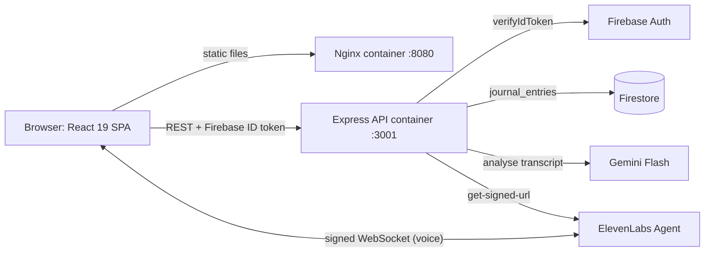

# DEEP-SYNC — Neural Wellness Journal

> An AI-powered voice journaling platform. Speak your thoughts; receive mood analysis, summaries, and personalised advice — all privately stored under your own account.

[](https://your-app.vercel.app)
[](https://github.com/nap001/ElevenLab-Challenge/actions/workflows/ci.yml)

---

## ✨ Features

- 🎙️ **Voice-first journaling** — powered by the ElevenLabs Conversational AI Agent
- 🧠 **AI analysis** — Gemini 3.8 Flash extracts mood, summary, and personalised advice from each session
- 🔐 **Secure & private** — Google Sign-In via Firebase Auth; each user's data is isolated in Firestore
- 📜 **Memory Log** — browse your full history of past journal entries

## 🛠️ Tech Stack

| Layer | Technology |
|---|---|
| Frontend | React 19, Vite, Tailwind CSS, Framer Motion |
| Backend | Node.js, Express 5, Helmet, express-rate-limit |
| Auth | Firebase Authentication (Google OAuth) |
| Database | Firebase Firestore |
| AI (Voice) | ElevenLabs Conversational AI Agent |
| AI (Analysis) | Google Gemini 3.8 Flash |

---

## Architecture Overview



- **Frontend** (`client/`): React 19 + Vite + Tailwind + Framer Motion, served as a static bundle by Nginx with SPA fallback.
- **Backend** (`server/`): Express 5. `app.js` defines the app (Helmet, CORS, 100 req/15 min IP rate limit on `/api`, `GET /health`); `index.js` only loads env and listens.
- **Auth**: the browser signs in with Firebase; every API call carries the ID token, verified by `verifyToken` middleware.
- **Voice**: the backend mints a short-lived ElevenLabs signed WebSocket URL so the API key never reaches the browser.
- **Analysis**: transcripts are sanitised, sent to Gemini (retry on 503), and stored per-user in Firestore.

---

## Quickstart with Docker

Requires Docker with the Compose plugin.

```bash
cp .env.example .env        # fill in Firebase, ElevenLabs and Gemini values
docker compose up --build
```

- Frontend: http://localhost:8080
- Backend health: http://localhost:3001/health

Notes:

- `GOOGLE_CREDENTIALS_JSON` in `.env` is the Firebase service-account key as one line of JSON (see `.env.example`).
- `VITE_*` values are public web config baked into the frontend at **build** time. Re-run with `--build` after changing them.
- Both images are built from pinned base images; the backend runs as the non-root `node` user and has a `/health` Docker healthcheck.

---

## Testing & CI

```bash
cd server && npm ci && npm run lint && npm test   # Jest + Supertest, fully offline (all external APIs mocked)
cd server && npm run test:live                    # Live smoke check against real Gemini + Firestore (catches retired models / bad keys)
cd client && npm ci && npm run lint && npm run build
```

GitHub Actions (`.github/workflows/ci.yml`) runs `backend-check`, `frontend-check` and `docker-build` (Buildx, no push) on every push and PR to `main`.

---

## 📂 Project Structure

```
ElevenLab_Challenge/
├── client/                     # React + Vite frontend
│   └── src/
│       ├── config/             # Firebase client config (reads from env vars)
│       ├── hooks/              # useAuth, useConversationSession
│       ├── pages/              # AuthPage, JournalView, HistoryView
│       └── services/           # api.js — all backend API calls
└── server/                     # Node.js + Express backend
    └── src/
        ├── config/             # Firebase Admin + Gemini SDK setup
        ├── middleware/         # verifyToken auth middleware
        ├── routes/             # api.js — all Express routes
        └── services/           # geminiService, journalService
```

---

## 🚀 Running Locally (without Docker)

### Prerequisites

- Node.js 20+ (24 LTS recommended, see `.nvmrc`)
- A [Firebase project](https://console.firebase.google.com/) with **Authentication** (Google provider) and **Firestore** enabled
- An [ElevenLabs](https://elevenlabs.io/) account with a Conversational AI Agent created
- A [Google AI Studio](https://aistudio.google.com/) Gemini API key

### 1. Clone the repo

```bash
git clone https://github.com/your-username/your-repo.git
cd your-repo/ElevenLab_Challenge
```

### 2. Set up the server

```bash
cd server
npm install
cp .env.example .env
```

Open `server/.env` and fill in your values:

```env
PORT=3001
AGENT_ID=           # ElevenLabs → your Agent ID
XI_API_KEY=         # ElevenLabs → API Keys → your key
GEMINI_API_KEY=     # Google AI Studio → Get API Key
ALLOWED_ORIGIN=http://localhost:5173
```

You also need a Firebase service account key:
1. Firebase Console → Project Settings → Service Accounts → **Generate new private key**
2. Save the downloaded JSON as `server/service-account.json`

> ⚠️ `service-account.json` is git-ignored — never commit it.

### 3. Set up the client

```bash
cd ../client
npm install
cp .env.local.example .env.local
```

Open `client/.env.local` and fill in your Firebase **web app** config  
(Firebase Console → Project Settings → Your apps → Web):

```env
VITE_API_URL=http://localhost:3001
VITE_FIREBASE_API_KEY=
VITE_FIREBASE_AUTH_DOMAIN=
VITE_FIREBASE_PROJECT_ID=
VITE_FIREBASE_STORAGE_BUCKET=
VITE_FIREBASE_MESSAGING_SENDER_ID=
VITE_FIREBASE_APP_ID=
```

### 4. Run both servers

```bash
# Terminal 1 — backend
cd server && npm start

# Terminal 2 — frontend
cd client && npm run dev
```

Open **http://localhost:5173** in your browser.

